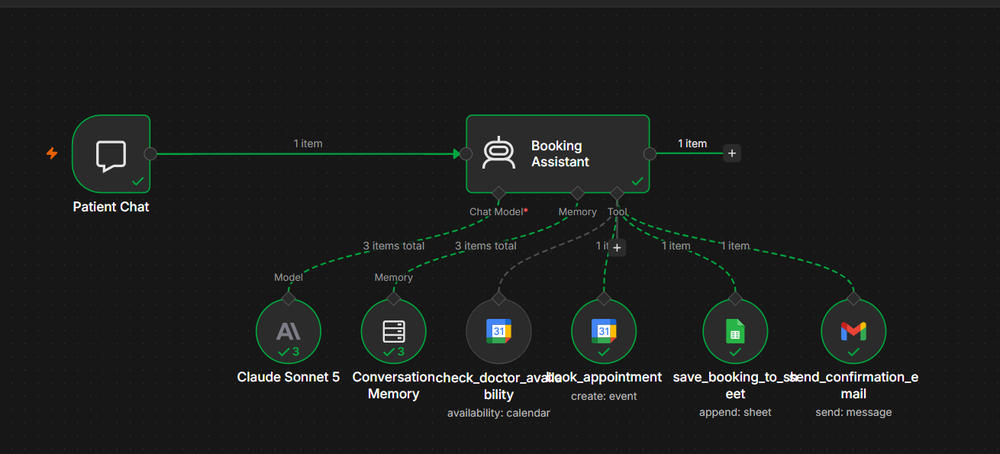
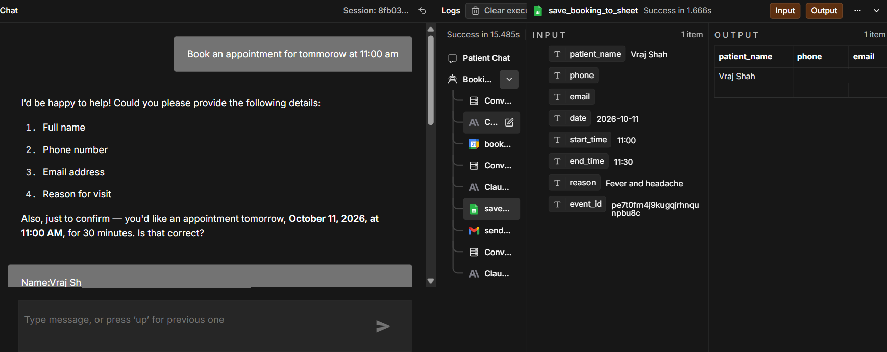
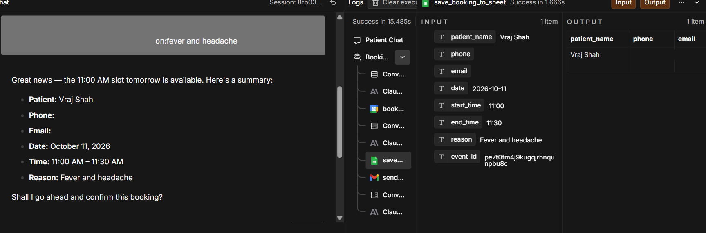
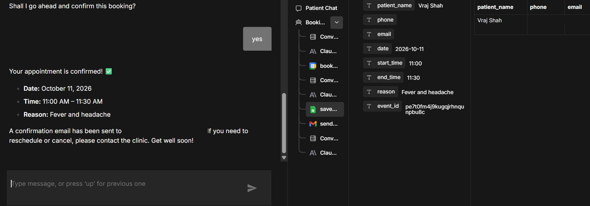
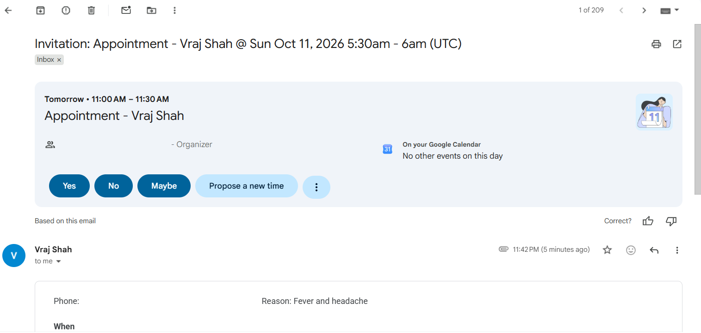

# AI Doctor Appointment Booking System

A chat-based **doctor appointment booking bot** built with **n8n** and an **AI agent (Claude Sonnet 5)**. A patient types naturally ("Book an appointment for tomorrow at 11:00 am"), and the agent checks the doctor's calendar, books the slot, logs it to Google Sheets and emails a confirmation.



## Problem

Booking a clinic appointment usually means phone calls, back-and-forth messages and manual entry into calendars and spreadsheets. Receptionists lose time, slots get double-booked, and patients wait for a reply.

## Solution

A conversational agent handles the whole flow:

- Understands natural-language requests ("tomorrow at 10") because it knows the current date and time (timezone Asia/Calcutta).
- Asks only for the details that are still missing.
- Checks real availability and offers nearby times if the slot is busy.
- Books only after the patient explicitly says "yes".
- Creates the calendar event, logs the booking and sends a confirmation email.

## Features

- Chat trigger that receives each patient message
- AI agent (Claude Sonnet 5) with a **window memory of the last 20 messages**
- Four tools acting on real systems:

| Tool | System | Purpose |
|------|--------|---------|
| `check_doctor_availability` | Google Calendar | Checks the requested 30-minute window |
| `book_appointment` | Google Calendar | Creates the event, invites the patient by email, returns an event ID |
| `save_booking_to_sheet` | Google Sheets | Appends a row with the booking details |
| `send_confirmation_email` | Gmail | Sends appointment details and how to reschedule or cancel |

- Explicit patient confirmation before anything is booked
- Honest failure handling (see below)
- 30-minute appointments by default

## Architecture

```
Patient Chat (chat trigger)
        |
Booking Assistant (AI Agent)
        |-- Claude Sonnet 5 (chat model)
        |-- Conversation Memory (last 20 messages)
        |-- check_doctor_availability  (Google Calendar)
        |-- book_appointment           (Google Calendar)
        |-- save_booking_to_sheet      (Google Sheets)
        '-- send_confirmation_email    (Gmail)
```

### A typical conversation

1. **Patient:** "Book an appointment for tomorrow at 11:00 am."
2. **Collect details:** the agent asks only for what's missing: full name, phone, email, reason for the visit.
3. **Check availability:** it calls `check_doctor_availability` for that 30-minute window. If the slot is busy, it offers nearby times and checks those.
4. **Confirm with the patient:** it summarises date, time and details and waits for an explicit "yes". Nothing is booked before that.
5. **Book** (in this order, after "yes"):
   1. `book_appointment` creates the calendar event and invites the patient by email, returning an event ID.
   2. `save_booking_to_sheet` records name, phone, email, date, start time, end time, reason and event ID.
   3. `send_confirmation_email` sends the patient the details and how to reschedule or cancel.
6. **Reply:** the agent tells the patient the booking is confirmed.

### When something fails

- **Calendar or sheet step fails:** the agent tells the patient the booking isn't fully confirmed and does **not** send the email.
- **Only the email fails:** the agent says the booking is confirmed but the email couldn't be sent.

### Agent rules

- Never gives medical advice; points emergencies to local emergency services
- Never books in the past
- Never reveals other patients' details
- Appointments are 30 minutes unless the patient says otherwise

## Setup

### Prerequisites
- An n8n instance (cloud or self-hosted)
- A Google account (Calendar, Sheets and Gmail OAuth)
- An Anthropic API key

### Steps

1. **Import the workflow:** in n8n, *Workflows -> Import from File* and select `workflow.json`.
2. **Create credentials** in n8n (none are included in this repo): Anthropic API, Google Calendar OAuth2, Google Sheets OAuth2, Gmail OAuth2.
3. **Create a Google Sheet** with these headers in row 1:
   `patient_name | phone | email | date | start_time | end_time | reason | event_id`
4. **Select your credentials** on the Claude, Calendar, Sheets and Gmail nodes, then choose your calendar (replace `YOUR_CALENDAR_ID`) and your spreadsheet (replace `YOUR_SPREADSHEET_ID`).
5. **Check the timezone** in the agent's system message (currently `Asia/Calcutta`) and change it if needed.
6. **Test** with one real chat in the n8n chat window, then check the calendar, sheet and inbox.
7. **Activate** the workflow.

## Screenshots

| Booking request | Confirmation summary |
|---|---|
|  |  |

| Booking confirmed | Calendar invitation email |
|---|---|
|  |  |

Personal details (phone numbers and email addresses) are blurred in the screenshots.

## Privacy and safety

This bot handles personal data (names, phone numbers, emails, visit reasons). Use it only with patient consent, restrict access to the calendar and sheet, and follow the privacy rules that apply to your clinic. The bot gives no medical advice. `workflow.json` contains no credentials or secrets.
